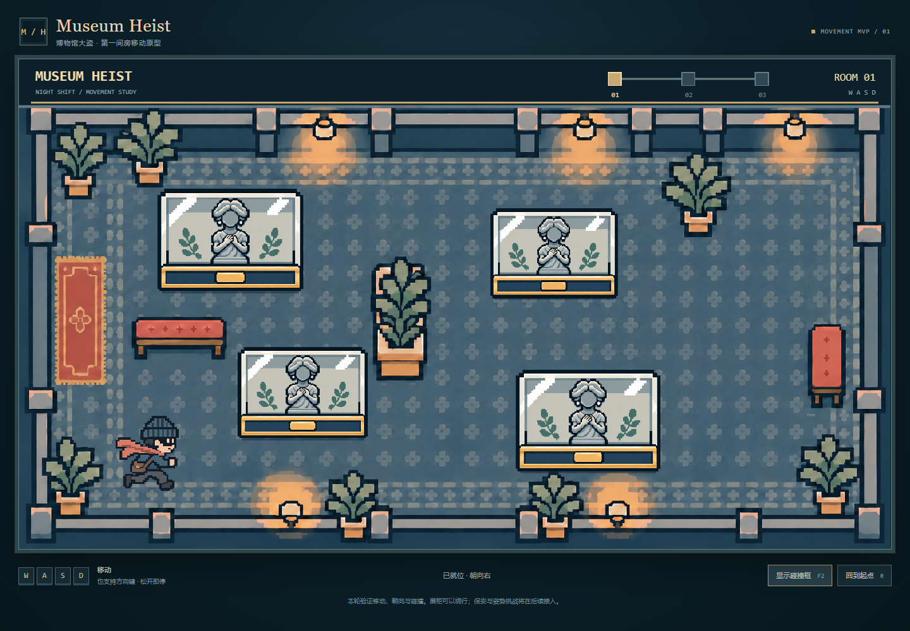

# Museum Heist

**Current implementation: Room 1 movement MVP, 9 November 2026.** Use WASD to move one character through a museum room, change between four static facing images, and collide with walls and furniture. This is the first runnable slice of a planned three-room stealth and upper-body pose game.



## What works now

- WASD and arrow-key movement; releasing the keys stops movement and preserves facing.
- A single configured speed of **220 logical pixels/second**, normalised on diagonals. The latest active direction controls facing.
- Four transparent character PNGs, aligned to one feet anchor despite different source dimensions.
- Phaser Arcade collisions using a 34 by 20 logical-pixel feet body, room boundaries, four display-case bases, plant pots and two benches.
- Transparent foreground for all eight plants: foliage hides a player standing behind it, while pots block movement. The central plant additionally blocks its entire foliage-and-pot rectangle. Plant colours remain sampled from the original background.
- Both lower lamp fixtures occlude the player without adding collision; upper lamps are unchanged. Both benches have foreground artwork and lower-base collision only.
- A separate team-supplied blue image sits underneath an exhibit only when its opaque artwork completely hides the character. It disappears when the character becomes visible again. The previous elliptical ring is removed; highlight and exhibit images remain independently replaceable.
- A 1600 by 900 logical scene, proportional FIT scaling and nearest-neighbour image sampling.
- F2 or the visible button toggles collision outlines; R or the reset button returns the character to its starting point.
- Leaving the game canvas, switching away or losing focus clears held movement. Missing image assets produce a loading-error message with a reload button.

There are no guard patrols, alert calculations, camera requests, pose recognition, walking frames, room transitions or treasure-unlock logic in this MVP. The three-node HUD is a static route reference, not implemented progression.

## Run on Windows

Open PowerShell in **this `LFG` repository**, then run:

```powershell
powershell -NoProfile -ExecutionPolicy Bypass -File .\start.ps1
```

Open **http://127.0.0.1:5173/**. Click the game if the keys do not respond. Keep the terminal open; `Ctrl+C` stops the server. The first run installs the locked dependencies and needs internet. The script uses an installed Node.js, or the existing E-drive Codex runtime when available on the development computer. On another computer, install Node.js 24 LTS first. No camera or paid service is needed.

If 5173 is occupied, stop an earlier copy of this game's server before retrying. Do not double-click `index.html`: Vite serves the modules and assets over HTTP.

## Standard developer commands

With Node.js and pnpm installed:

```bash
pnpm install --frozen-lockfile
pnpm dev
pnpm test
pnpm build
pnpm preview
```

The production preview uses http://127.0.0.1:4173/. Alternatively, the Windows helper can build with:

```powershell
powershell -NoProfile -ExecutionPolicy Bypass -File .\start.ps1 -Build
```

### Pose Shadow Lab handoff

When the character is fully behind a display case and its blue frame is visible, press **Space** to open the pose-shadow challenge. Start the camera to grant browser-local pose detection, then hold the highlighted target pose to progress through the three statue-inspired tasks. The MediaPipe model and runtime are loaded from public hosting on first use; camera frames and landmarks are not recorded or uploaded by this app.

Dependencies are pinned in `package.json` and `pnpm-lock.yaml`: React/React DOM 19.3.1, Vite 8.3.7 and Phaser 3.90.0. This deliberately uses the documented Phaser 3 API. The project does not require the experimental UI-kit ZIP or the full composite concept image at runtime.

## Assets inspected and used

The supplied `back.png` is character-free in the room but contains a baked top HUD. `Room1` selects the room texture frame below source y=90; React and Phaser draw the new static HUD separately. The complete concept image containing a fixed player, guard and red cone is **not loaded**.

All four supplied player images contain a real alpha channel. Their actual facing is:

| Source file supplied by the team | Runtime copy | Facing |
| --- | --- | --- |
| `image 46.png` | `public/assets/player/right.png` | Right / D |
| `image 47.png` | `public/assets/player/down.png` | Front / S |
| `image 48.png` | `public/assets/player/up.png` | Back / W |
| `image 49.png` | `public/assets/player/left.png` | Left / A |

The pose challenge uses MediaPipe Tasks Vision / Pose Landmarker Lite for browser-local, single-person upper-body landmark detection. The web font is loaded from Google Fonts.

Source PNGs are copied byte-for-byte. Visible-art rectangles and per-image feet positions create equal-sized runtime textures without flattening transparency, stretching art, or replacing missing directions. The same `sculpture.png` is reused for four separate display cases. Guard images were inspected but are not needed or bundled in this movement-only stage. See [ASSETS.md](ASSETS.md) for provenance and hashes.

## Where to adjust the prototype

- `src/game/config.js`: movement speed, spawn, source-image frames, feet body, walkable bounds and all obstacle coordinates. Obstacles use the background's original coordinate system and one shared mapping into the 16:9 scene.
- `src/game/movement.js`: input normalisation and facing selection.
- `src/game/plant-foreground.js`: alpha-guide cleanup and original-colour plant extraction; foliage is rendered separately from pot colliders.
- `src/game/scenery-foreground.js`: source-colour bench/lower-lamp selection and compact foreground clipping paths.
- `src/game/occlusion.js`: cached alpha masks and complete-character coverage checks for the exhibit underlay.
- `src/game/Room1.js`: asset loading, Phaser scene, collision bodies, input lifecycle, reset and debug drawing.
- `src/main.jsx`: React mount, canvas lifecycle, readable HUD labels, controls and loading/error feedback.
- `src/styles.css`: responsive layout and pixel-image presentation.

The small feet body deliberately permits moving visually behind tall art. Display cases, plant foregrounds and benches sort against the player's feet-y position. Each plant's full foliage is a transparent drawing layer; the central plant blocks its complete drawing rectangle, while the other seven retain their original pot-only collision. The benches block feet only at their lower bases; their upper artwork occludes characters behind them. The two lower lamps occlude without creating bodies, and their surrounding glow remains on the background. Source artwork is preserved using clipped instances of the original room texture. Collision outlines show the actual blocking rectangles. See [the plant extraction record](docs/plant-foreground.md).

Exhibit highlighting uses the separate `public/assets/exhibits/sculpture2.png` layer below the original exhibit image. Its full source canvas is aligned through `EXHIBIT_HIGHLIGHT_ART.registration` in `config.js`; it is not flattened into the exhibit. See [exhibit layer setup](docs/exhibit-layers.md) before replacing exhibit artwork.

## Verification and limits

See [tests/TESTING.md](tests/TESTING.md) for checks actually run. Automated input/configuration tests and browser movement/collision checks are distinct from a human playtest. Physical mobile keyboards, touch controls, Safari/Firefox and prolonged performance have not been verified. The original reference contains soft shading, so nearest-neighbour rendering preserves its source appearance rather than turning it into a new hand-pixelled asset set.

## Planned next stages

The intended game has three rooms, a patrolling guard, visible detection cones, emergency upper-body pose imitation, and a final antique/treasure objective. Next, add one guard and an explicit pause/resume boundary before connecting a single MediaPipe pose. These features remain plans; running the current prototype does not request camera permission.

The existing [project overview](museum-heist-project-overview.md) and [movement brief](codex-mvp-movement-brief.md) remain design documents. The older camera-based wording in the initial plan has evolved toward the supplied guard-based concept.

## Credits and development

Team-supplied artwork, third-party libraries and AI assistance are documented in [CREDITS.md](CREDITS.md). This pass adds a runnable MVP to the previously planning-only repository. No commit, push, public deployment or Canvas submission is performed automatically.
