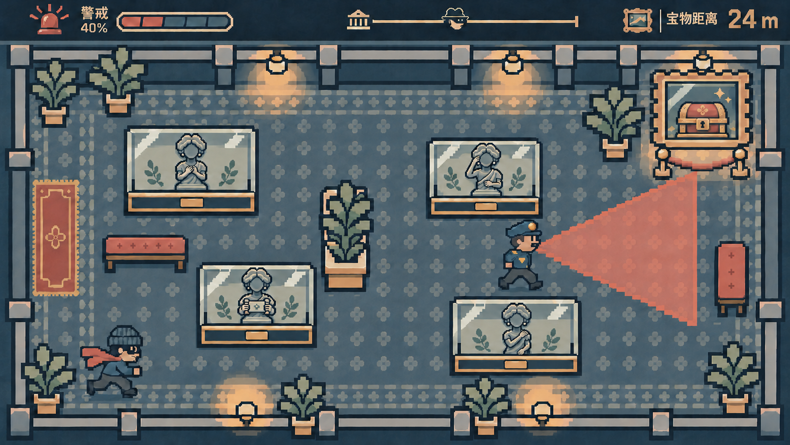
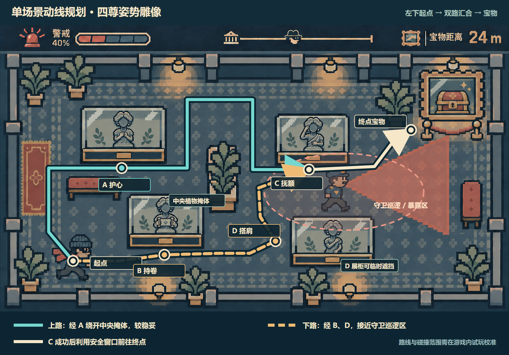

# Museum Heist · 四雕像展厅设计稿

本目录集中存放一间展厅的四尊动作雕像、场景与动线设计，以及每尊雕像对应的姿势扫描视觉稿。场景**上方中央与下方中央的两个门已移除**，墙面和地面纹样连续；玩家起点仍位于左下。**这是设计资源，不是已经接入游戏的关卡。**画幅以 1672 × 941 px 为基准。

## 完整场景与动线

玩家从左下进入。上路经过 **A 护心**，从中央植物上方绕到 **C 抚额**；下路经过 **B 持卷** 和 **D 搭肩**，从中央植物右侧到 C。下路较短，但接近守卫巡逻区。四个展柜、长椅和中央植物可供遮挡；C 成功后可利用短暂安全窗口向右上宝物移动。具体拐点、交互位置、掩体框和巡逻示意值见 [`scene-layout.json`](scene-layout.json)。这些数值需要在运行中的关卡里校准。

## 四尊雕像与扫描界面

| 位置 | 坐姿可完成的动作 | 透明底雕像 PNG | 扫描界面视觉稿 | 识别目标 ID |
| --- | --- | --- | --- | --- |
| A 左上 | 双手护在胸前 | [01-hands-at-heart.png](statues/01-hands-at-heart.png) | [护心扫描界面](pose-screens/01-hands-at-heart.png) | `hands-at-heart` |
| B 左下 | 双手在胸前如持短卷 | [02-holding-scroll.png](statues/02-holding-scroll.png) | [持卷扫描界面](pose-screens/02-holding-scroll.png) | `holding-scroll` |
| C 右上 | 右手轻扶额角 | [03-hand-on-head.png](statues/03-hand-on-head.png) | [抚额扫描界面](pose-screens/03-hand-on-head.png) | `hand-on-head` |
| D 右下 | 右手横过胸前搭左肩 | [04-hand-on-shoulder.png](statues/04-hand-on-shoulder.png) | [搭肩扫描界面](pose-screens/04-hand-on-shoulder.png) | `hand-on-shoulder` **待开发** |

四张 `statues/*.png` 均含真实透明 alpha 和底座。源图留有透明边距；接入绘制时可按 [`statue-bounds.json`](statue-bounds.json) 中的 `alphaBounds` 裁取实际内容区域，再缩放到展柜位置。`inspect-statues.ps1` 可重新计算边界。`generate-route-plan.js` 可根据本目录的 `planned-scene.png` 重新生成自包含的 [`route-plan.svg`](route-plan.svg)；`route-plan.png` 是其渲染预览。

## 接入状态

团队的 [`feat/pose-shadow-demo` 分支](https://github.com/sd5913/LFG/tree/feat/pose-shadow-demo)已有前三种动作的上半身识别演示，保持时间约 2 秒。**D 搭肩仅完成视觉稿**；代码还需新增目标姿势、肩肘腕关键点判定与误判测试，特别要区别于 A 护心。扫描图中的 `05 秒` 是视觉示例；当前演示代码的挑战倒计时为 10 秒，整合时应统一。

`pose-screens/` 是完整概念画面；运行游戏时应使用可拆 UI 面板、实时文本/数值和摄像头关键点，不能将整张截图当作交互层。场景图中的四尊雕像和透明 PNG 是分别生成的视觉素材，像素细节略有差异；正式关卡应以透明 PNG 为准进行拼装。守卫视线遮挡需要由碰撞与视线逻辑判断，不能直接以图上的光锥决定。

场景、雕像和扫描视觉稿以项目已确认的低饱和像素风为参考，使用 OpenAI imagegen 辅助生成；动线图与坐标清单由代码整理。参考用的原始 UI 分解包未重复加入本分支。
