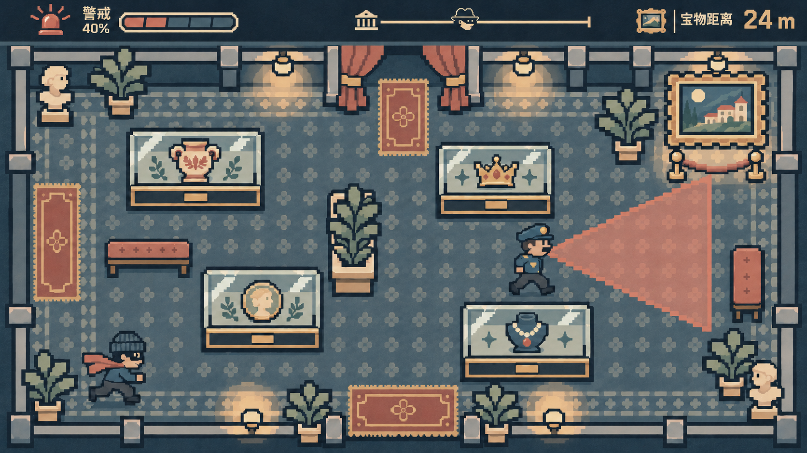
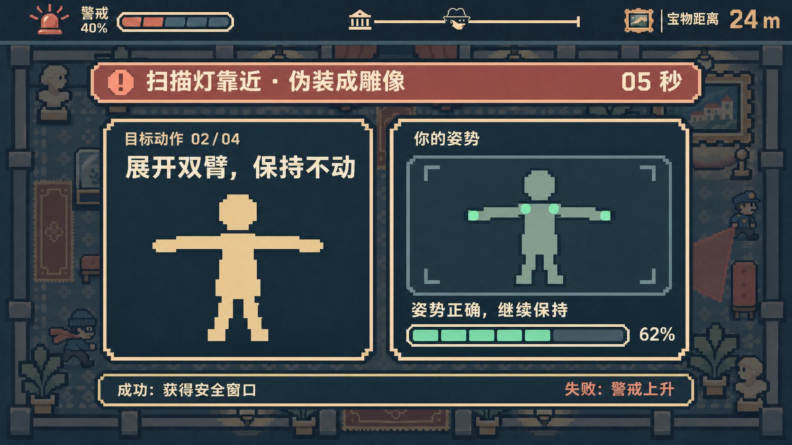

# Museum Heist · UI/UX 与视觉设计进展

此目录保存目前的设计稿和可拆分游戏素材，供小组在独立分支中查看、讨论和接入原型。画面中的警戒百分比、宝物距离、扫描倒计时和姿势保持进度均为**示例数值**，实际游戏应由代码计算。当前素材是视觉与交互原型，尚未代表已完成的游戏功能。

## 两张主界面图

### 主游戏画面

### 途中姿势扫描画面

两张图片与本次提交时确认的界面截图一致。整体采用低饱和灰蓝、暖金和砖红配色，以及清晰可见的方块像素。

## 七个页面的低保真线框图

线框用于确定信息和按钮的位置，画幅均为 1280 × 720；它们不是最终视觉稿。[查看七页总览](wireframes/overview.svg)和[线框说明](wireframes/README.md)。

| 阶段 | 线框 |
| --- | --- |
| 开始页 | [01-start.svg](wireframes/01-start.svg) |
| 摄像头授权与校准 | [02-camera.svg](wireframes/02-camera.svg) |
| 游戏中 | [03-game.svg](wireframes/03-game.svg) |
| 途中姿势挑战 | [04-pose.svg](wireframes/04-pose.svg) |
| 开锁 | [05-unlock.svg](wireframes/05-unlock.svg) |
| 胜利 | [06-victory.svg](wireframes/06-victory.svg) |
| 失败 | [07-failure.svg](wireframes/07-failure.svg) |

## 可拆分素材

- [游戏场景与通用 UI 素材说明](assets/README.md)：静态背景、透明人物与展柜 PNG、透明 SVG 按钮/图标/姿势部件，以及坐标配置。可在本地打开 [`assets/preview.html`](assets/preview.html) 查看拼装效果，打开 [`assets/gallery.html`](assets/gallery.html) 检查透明素材。
- [姿势扫描 UI 素材说明](assets/pose-scan-ui/README.md)：顶部 HUD、警戒条 **0%–100%（每 10%）**、警告横幅、目标姿势、识别框、保持进度条 **0%–100%（每 10%，另有 62%）** 和底部结果栏。可在本地打开 [`assets/pose-scan-ui/preview.html`](assets/pose-scan-ui/preview.html) 切换进度状态。

`assets/scene-layout.json`、`assets/alpha-bounds.json` 和 `assets/pose-scan-ui/manifest.json` 提供各部件的位置、透明内容边界及动态文本位置，便于在游戏代码中逐层绘制。透明素材与完整界面图为分别制作，组合后会有少量细节差异。

## 当前待确认

- 仓库规划中的最终战利品是可携带古董；现有画面与拆分素材暂用名画作终点视觉占位，接入前需与小组确认最终物件。
- 姿势挑战次数、开锁规则、失败后的重试起点和摄像头检测阈值仍需开发与试玩确认。

两张主界面图及背景、角色等位图由 OpenAI imagegen 辅助生成；线框与拆分 SVG 由代码绘制。设计素材的生成方式和使用限制详见各子目录说明。
