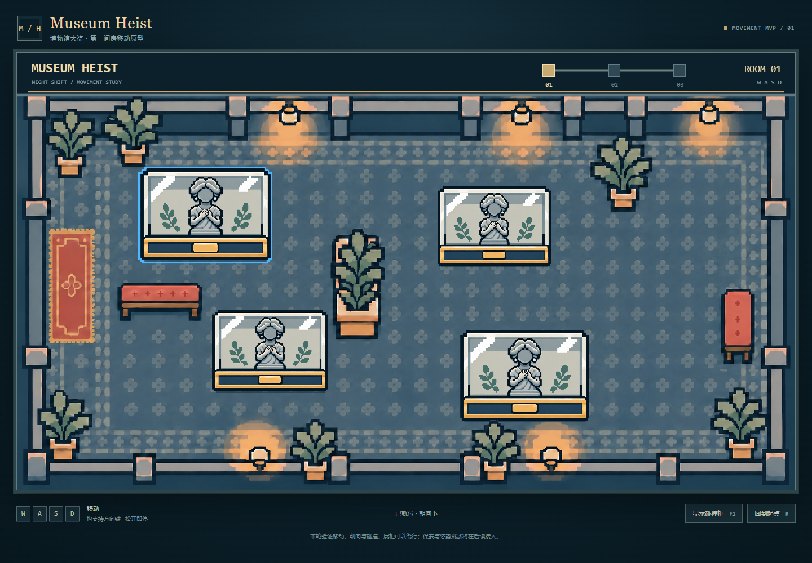

# Separate exhibit and highlight layers

Updated 10 November 2026. The old Canvas ellipse is no longer created or drawn.

Each entry in `Room1.exhibits` contains two independent Phaser images:

- `image`: the existing exhibit artwork (`case-source`, frame `case-only`). It provides the visible exhibit and the alpha used for complete-character occlusion checks.
- `highlight`: the supplied `sculpture2.png` (`case-highlight-source`), with its full 1536 × 1024 canvas and original alpha, placed directly below that exhibit at `image.depth - 0.1`.

Only the highlight belonging to the completely hiding exhibit is visible. Partial exposure, walking to the front, walking out and resetting hide the underlay. Collision bodies, feet-y sorting and the complete-coverage rule are unchanged. The highlight does not create a physical body or participate in occlusion detection.

## Alignment and future artwork replacement

`SCULPTURE_ART.file` and `SCULPTURE_ART.bounds` in `src/game/config.js` define the exhibit artwork. `EXHIBIT_HIGHLIGHT_ART.file` independently defines the highlight. Its `registration` rectangle `[348, 211, 841, 602]` identifies the corresponding exhibit rectangle within the highlight's source canvas.

`alignExhibitHighlight()` maps that reference rectangle onto the current exhibit's world bounds. The complete highlight canvas therefore extends beyond the cropped exhibit without stretching or recentring the reference incorrectly. Both images then follow the same Phaser camera and FIT scaling.

To replace the exhibit artwork later, provide an aligned exhibit PNG and update its file/bounds. Keep the highlight PNG separate; do not replace the runtime exhibit with `sculpture3.png`, which is a flattened reference. A new highlight with a different reference frame can be configured through its own `registration` values. Source alpha is retained, so the supplied image's faint external marks remain faint rather than being artificially made opaque.

The original supplied files are not overwritten. The project copy of `sculpture2.png` is byte-identical to the source. The supplied reference composite is not bundled. No new image-generation call was needed for this change.
