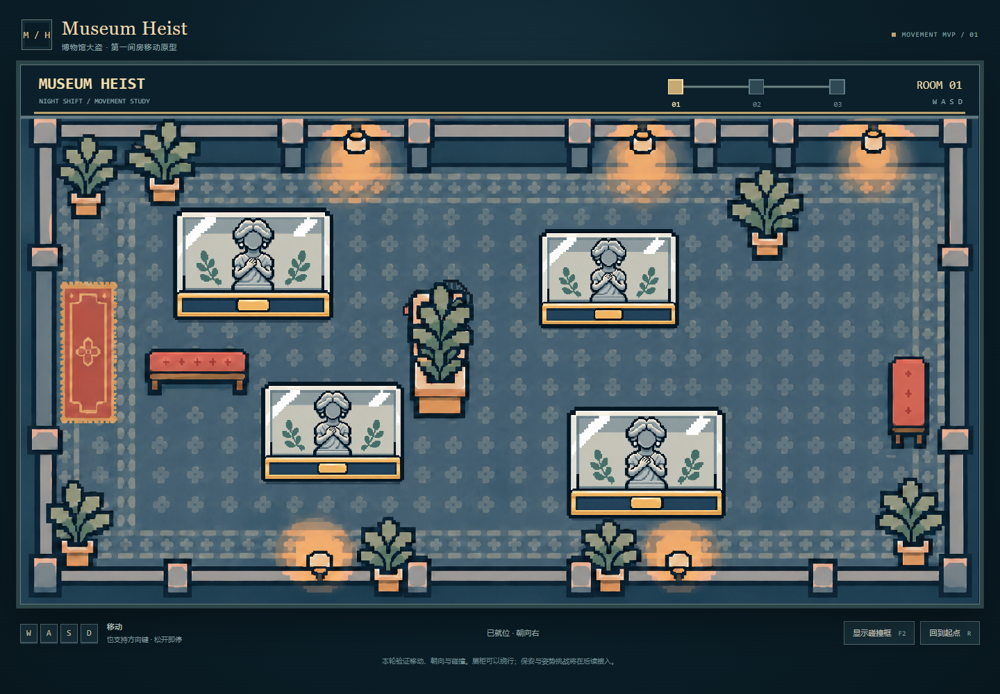
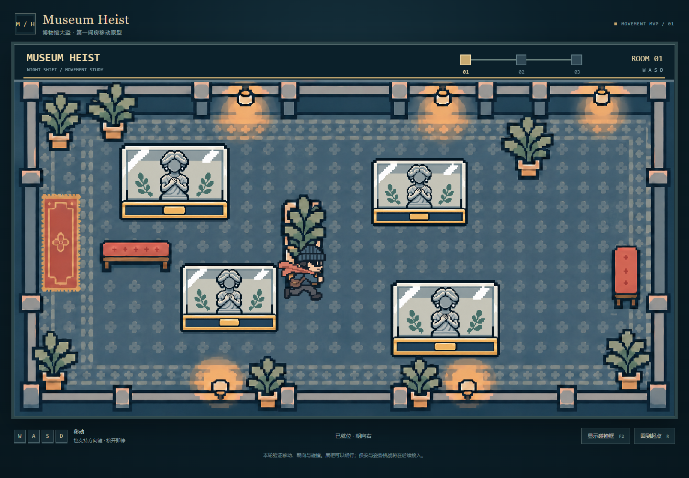
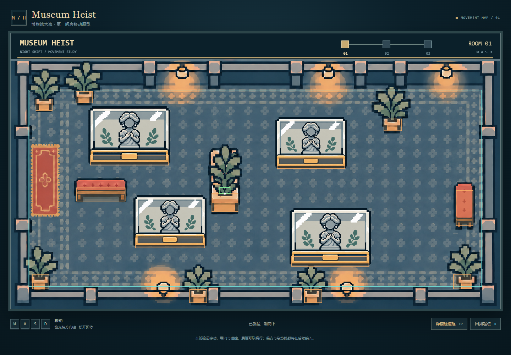

# Transparent plant foreground

Date: 9 November 2026. Input: the team's original `public/assets/room/back.png`. Tool mode: built-in image_gen, background extraction with `transparent_background: true`; no external API key or CLI image service.

## Prompt used

> Use case: background-extraction. Edit target: the supplied 1670 by 941 pixel museum game background. Produce a transparent foreground occlusion layer extracted from this exact image, NOT new artwork. Retain ONLY the eight potted plants (all leaves, dark outlines, stems, terracotta pots and the central plant's narrow wooden support). Remove every floor tile, floor pattern visible BETWEEN leaves, all walls, benches, lights, HUD, icons and text, replacing them with genuinely transparent alpha. Keep all eight plants at their exact original positions, sizes and orientation on the same full landscape canvas, ideally exactly 1670x941 pixels: two plants in upper left, one upper right, one tall central plant, one lower left, two along bottom wall, one lower right. Keep the precise original stepped pixel silhouettes, original muted green leaves, navy outlines and peach pots. Preserve a separate clear transparent gap around and within each plant silhouette. This is an aligned game foreground mask to overlay the unchanged source background, so do not redesign, move, centre, resize, add, omit or duplicate any plant. No checkerboard, no black/white background, no floor halo, no ground shadow outside the existing plant outlines. Output PNG with real transparency.

## Integration decisions

- The output has genuine alpha but is 1670 × 942 and has small generative differences. It is therefore used as a selection guide, not directly painted on top of the room.
- Runtime Canvas maps its alpha to the source image size, limits selection to the eight plant frames and rejects blue-grey floor pixels. A two-source-pixel guide tolerance retains fine outline edges. Every displayed opaque RGB pixel comes from the original room.
- One shared 1670 × 851 transparent atlas represents the room below the original y=90 HUD. Geometry-clipped instances share the background origin and transform, avoiding the half-pixel scaling difference of independently cropped images in the Canvas renderer.
- Each plant sorts by its pot-bottom y against the player's feet y. Pot-only collision coordinates are unchanged; leaves and transparent gaps add no body.
- The original-colour atlas is also exported as `public/assets/plants/foreground.png` for the team to inspect or reuse. The generated selection guide remains in `foreground-guide.png` for reproducibility.

## Preview

The screenshots and browser report use diagnostic starting positions followed by production rendering and native keyboard movement. They do not represent a human playtest.
